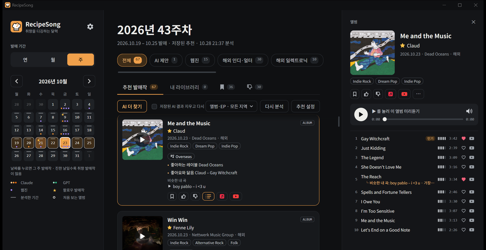
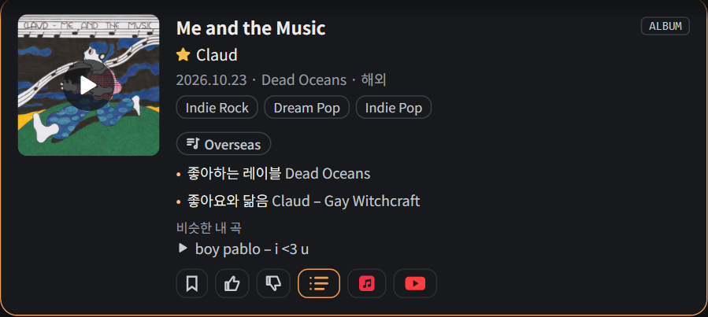
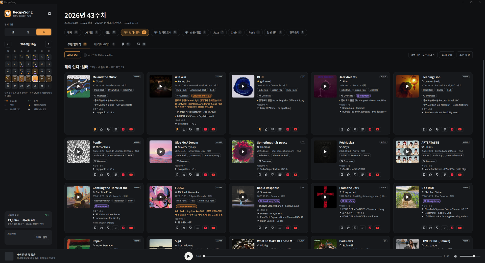
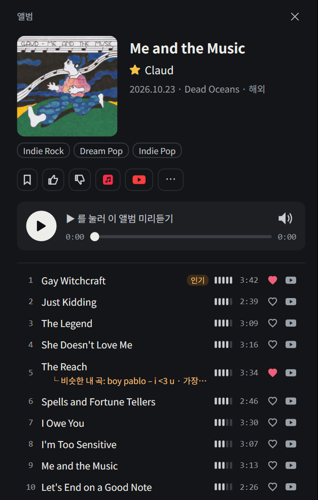
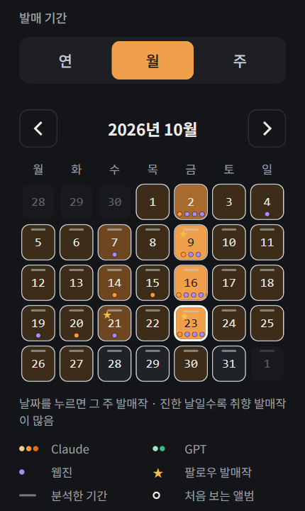
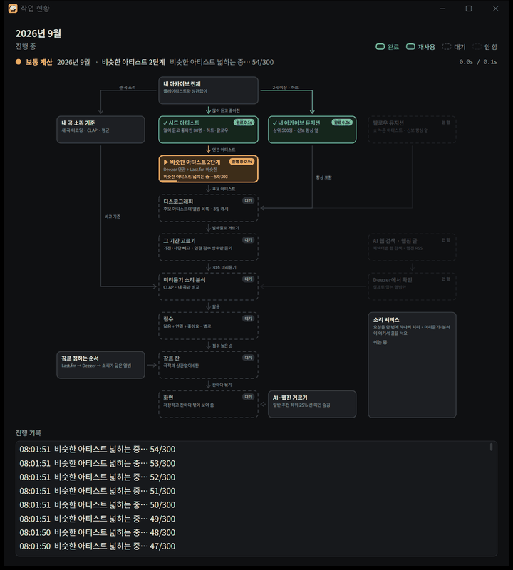

# RecipeSong

**취향을 디깅하는 달력.** 달력에서 주·월·연을 고르면 그 기간에 나온 앨범·EP·싱글 가운데
내 iTunes 라이브러리와 **소리가 닮은 것**을 골라 준다. 장르 태그나 인기 순위가 아니라
미리듣기를 직접 듣고 내 곡과 비교한다.



## 이런 점이 다르다

### 내 곡을 기준으로 듣고 고른다



- 플레이리스트를 따로 고를 필요 없이 **라이브러리 전체**의 소리와 비교한다. 많이 듣고 하트를 준 곡일수록 크게 치고, 받아만 두고 듣지 않은 곡은 뺀다.
- 고른 발매작은 **장르 칸**(인디·록 · 일렉트로닉 · 힙합·R&B · 재즈 · 클래식·OST · 그 밖)으로 나눈다. 장르는 Last.fm·Discogs·Deezer에서 가져오고, 없으면 소리가 닮은 앨범을 따라간다. 국적은 나누지 않는다.
- 카드마다 **왜 골랐는지**가 보인다: 좋아하는 레이블, 저장·좋아요한 앨범과 닮음, 그리고 **비슷한 내 곡**. 누르면 내 파일로 바로 비교해 들을 수 있다.
- 소리 분석은 내 PC에서 돈다 (CLAP 임베딩, GPU). 라이브러리에 곡이 늘면 새 곡만 분석한다.

넓은 화면에서 칸 하나만 펼친 모습. 카드마다 추천 이유와, 내 음악 아카이브에 있는 곡 중 소리가 비슷한 곡이 붙는다.



### 앨범 한 장을 곡 단위로



- 카드를 열면 오른쪽 창에 수록곡이 나온다. 곡마다 인기도, 30초 미리듣기, **그 곡과 닮은 내 곡**.
- 재생 칸이 앨범 바로 아래 붙어 있어 들으면서 저장 · 좋아요 · 관심 없음 · 팔로우 · 차단을 그 자리에서 한다.
- `Space` 재생/일시정지, `←` `→` 곡, `↑` `↓` 앨범, `Esc` 닫기.

### 달력이 기억한다



- 진한 날일수록 내 취향 발매작이 많은 날. 계산해 둔 기간(회색 선), AI가 찾은 날(Claude 주황 · GPT 초록 점), 웹진 소개(보라 점, 몇 곳이든 하나), Last.fm이 이어 준 아티스트(붉은 점), 팔로우 아티스트 발매(★)가 한눈에 보인다.
- 한 번 계산한 기간은 저장해 두고 바로 연다. 오래된 결과도 먼저 보여 주고 뒤에서 새로 계산한다.
- 지난 해도 그대로 고를 수 있다. 월·연 보기는 "주별로 촘촘히 계산"으로 주 단위로 쪼개 촘촘하게 (이미 계산한 주는 건너뛴다).

### 더 넓게 찾고 싶을 때

- **AI 커넥터 (선택)**: Claude · GPT API 키를 넣으면 AI가 웹을 검색해 발매작을 더 찾는다. Deezer에서 실제로 있는지 확인하고, 내 곡과 닮은 정도가 그 기간 일반 추천의 하위 25% 선을 넘는 것만 카드로 나온다. 하루·주 한도와 사용액 표시.
- **웹진**: Pitchfork · The Quietus · Aquarium Drunkard · Bandcamp Daily · Stereogum 이 소개한 앨범을 6시간마다 가져와 배지로 붙인다. AI 커넥터와 같은 닮음 기준을 넘어야 보인다.
- **팔로우**: ★를 누른 아티스트의 발매작은 항상 맨 앞에.
- **Last.fm 비슷한 아티스트**: Deezer 연관 아티스트에 Last.fm이 잇는 비슷한 아티스트를 더한다. Deezer가 잘 못 잇는 인디·한국·일본 아티스트가 후보에 들어오고, 그렇게 들어온 추천에는 Last.fm 배지가 붙는다.

### 계산이 어떻게 돌고 있는지 보인다



설정 → 고급 → **작업 현황 창 쓰기**를 켜면, 추천을 계산할 때 순서도 창이 떠서 지금 어느 단계인지 보여 준다 (메인 화면의 **현황** 버튼으로 열고 닫는다).

- 단계마다 완료(초록) · 진행 중 · 재사용(앞 계산이 만든 후보 목록) · 대기 · 안 함으로 칠하고, 걸린 시간과 진행 막대, 오래 조용하면 "n초째 소식 없음"을 붙인다.
- 보통 계산 · 주별 계산 · AI·웹진 · 팔로우 신보 · 장르 미리 받기 · 내 곡 분석이 동시에 돌면 계산마다 색으로 구분해 각자 있는 칸에 표시한다.
- **소리 서비스** 칸: 미리듣기·분석은 한 번에 하나씩 처리되므로, 지금 무엇을 처리하고 무엇이 줄을 서 있는지 보여 준다. 기다리는 이유가 바로 보인다.
- 그림은 처음 보는 달 하나를 계산하는 약 5분을 빠르게 돌린 것.

## 주요 기능

- **탭**: 추천 발매작 · 내 아카이브(그 기간에 나온, 내가 가진 앨범) · 저장함 · 관심 없음.
- **필터**: 장르 칩(끌어서 순서 변경), 형식(앨범·EP·싱글). 전체 보기는 칸마다 6장, "전체 N장 보기"로 펼친다.
- **학습 신호**: 저장 · 좋아요(앨범·곡) · 관심 없음 · 차단 사유(소리 때문인지)가 다음 추천에 바로 들어간다. 관심 없음·차단은 10초 안에 되돌릴 수 있다.
- **추천 설정**: 추천 양(기본/많이/최대), 모험 정도(익숙하게/보통/새롭게), 앨범에서 들을 곡(전곡/인기곡 3곡), 아는 아티스트 빼기, 인스트루멘털 버전 빼기, 팔로우·차단 목록.
- **언어**: 한국어 · English.

## 설치

`RecipeSong-Setup-<버전>.exe` 를 실행한다. 관리자 권한 없이 `%LOCALAPPDATA%\Programs\RecipeSong` 에 설치된다.

- .NET 런타임과 `uv` 가 같이 들어 있어 따로 설치할 것이 없다.
- 설치 마지막의 **소리 분석 환경 설치**(Python · PyTorch, 약 3GB)를 켜 두면 콘솔 창에서 내려받는다. 건너뛰면 앱이 소리 분석 서비스를 처음 띄울 때 받는다.
- 제거하면 Python 환경(`ml\.venv`)은 지우고 학습 결과(`ml\data`)는 남긴다. 다시 설치하면 이어서 쓴다.
- 인스톨러 만들기: `installer\build.ps1` (.NET 9 SDK, [Inno Setup 6](https://jrsoftware.org/isinfo.php), uv 필요). 결과는 `installer\out\`.

## 개발 실행

```powershell
dotnet run --project src/RecipeSong.Wpf
```

- 저장소의 `run-dev.cmd` 를 더블클릭해도 같다. 설치판과 캐시·설정을 같이 쓰므로 설치판이 켜져 있으면 실행하지 않는다.
- Windows 전용 (WPF, .NET 9).
- iTunes 라이브러리(`Music\iTunes\iTunes Music Library.xml`)는 자동으로 찾는다. 없으면 처음에 한 번 묻는다.
- 소리 분석 서비스는 `ml/` 폴더와 `uv`가 있으면 앱이 띄운다. 없으면 아티스트 연결만으로 추천한다.
- 창이 하얗게 나오던 문제 때문에 소프트웨어 렌더링이 기본이다. 하드웨어 렌더링: `CRATE_HW_RENDER=1`.

```
src/
  RecipeSong.Wpf    데스크톱 앱
  RecipeSong.Core   라이브러리 파싱, 후보 수집(Deezer), 장르 칸(Last.fm·Discogs·Deezer), 추천 점수, AI 커넥터, 소리 서비스 클라이언트
  RecipeSong.Cli    엔진 점검용 콘솔
  RecipeSong.Mcp    Claude Desktop/Code용 MCP 서버 (실험)
ml/
  service.py   소리 분석 서비스 (앱이 자동 실행, GPU)
  embed.py     라이브러리 음원 → CLAP 임베딩 (처음 한 번)
  train.py     취향 기준 (라이브러리 전체 임베딩 평균, 몇 초)
```

## 처음 한 번: 소리 분석

1. (저장소에서 실행할 때만) [uv](https://docs.astral.sh/uv/)를 설치하고 `cd ml; uv sync` (소리 분석에 쓸 Python 환경). 인스톨러로 설치했으면 건너뛴다.
2. 사이드바 "내 취향 모델"의 **분석 시작**을 누른다. 라이브러리 곡을 모두 듣는다 (1만 5천 곡이 RTX 3080 Ti로 약 1시간, 중간에 꺼도 이어서). 그동안에도 앱은 아티스트 연결만으로 추천한다.
3. (선택) 설정 → **장르 정보**에 [Last.fm API 키](https://www.last.fm/api/account/create)를 넣으면 장르 칸이 정확해진다. [Discogs 개인 토큰](https://www.discogs.com/settings/developers)도 넣을 수 있다. 키는 Windows 계정으로 암호화해 저장한다. 없으면 Deezer 장르와 소리로만 나눈다.

- 이후에는 앱이 iTunes 라이브러리 변경을 감지해 **새 곡만 분석**한다. 하트·별점·재생 수가 바뀐 것은 다시 분석하지 않아도 바로 반영된다.
- 닮음을 잴 때 하트·별 4개 이상 곡은 최대로 치고, 한 번도 안 듣고 넣은 지 석 달이 넘은 곡은 뺀다.
- (선택) 카드의 장르 태그: [Essentia 모델](https://essentia.upf.edu/models/feature-extractors/discogs-effnet/)에서 `discogs-effnet-bsdynamic-1.onnx`와 `.json`을 받아 `ml/data/models/`에 둔다. CC BY-NC-SA 4.0(비상업)이라 저장소에 넣지 않았다. 있으면 장르 칸을 정할 때도 쓴다.
- 모델: `laion/larger_clap_general`. (`laion/larger_clap_music` 체크포인트는 어떤 입력에도 같은 출력을 내는 고장 상태라 쓰지 않는다.)
- 명령줄로 하려면: `uv run python embed.py "<iTunes Music Library.xml>"` 다음 `uv run python train.py "<같은 xml>"`.

## 추천 방식

자세한 계산과 흐름도는 [docs/recommendation.md](docs/recommendation.md).

1. **시드**: 라이브러리에서 많이 듣고 좋아한 아티스트 80명 + 하트·팔로우한 아티스트
2. **후보**: Deezer 연관 아티스트 + Last.fm 비슷한 아티스트(1단계), Deezer 연관 2단계 → 상위 아티스트(추천 양에 따라 1,000~3,000명)의 디스코그래피
3. **기간 필터**: 그 기간에 발매된 작품 중 이미 가진 앨범 제외, 아티스트 연결 점수 상위
4. **소리**: 앨범 미리듣기(전곡 최대 20곡 또는 인기곡 3곡) → 내 곡 전체와의 유사도, 곡마다 가장 비슷한 내 곡
5. **점수**: 1.5 × 취향 유사도 + 아티스트 연결, 저장·좋아요와 닮으면 가산, 관심 없음·차단과 닮으면 감점
6. **칸**: Last.fm → Discogs → Deezer 장르 → 소리 장르 태그 → 소리가 닮은 앨범의 칸

라이브러리에서 많이 듣는 뮤지션(상위 500명)의 발매작은 점수와 상관없이 항상 나온다.

## 점검

```powershell
$env:CRATE_ITUNES_XML = "C:\Users\<me>\Music\iTunes\iTunes Music Library.xml"
dotnet run --project src/RecipeSong.Cli -- status
dotnet run --project src/RecipeSong.Cli -- recommend 2026-W43 --crate 인디·록 --type album --top 5
```

캐시와 로그: `%LOCALAPPDATA%\RecipeSong\` (`sound-service.log`는 소리 분석 서비스 로그).

## 한계

- 한국 인디 발매작은 Deezer의 아티스트 연결이 빈약해서 후보가 적다. Last.fm 태그도 적어 장르 칸은 소리로 정해지는 경우가 많다.
- 동명이인 아티스트는 Deezer·Last.fm 모두에서 섞일 수 있다 (차단 창에서 '이름만 같은 다른 아티스트'로 막는다).
- 미리듣기가 없는 앨범(발매 전, 일본 CD 전용 등)은 소리 판정 없이 나온다.
- iTunes는 곡별 마지막 재생일만 기록한다. 재생 수는 누적값이다.
