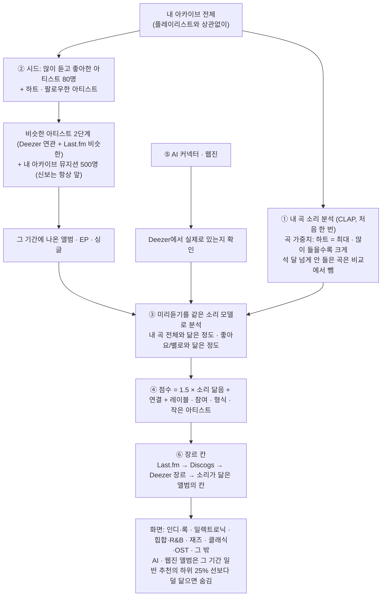

# RecipeSong 추천 방식

RecipeSong이 기간(주·월·연)마다 신보를 고르는 방식을 정리한 문서입니다. 숫자와 규칙은 2026-10-29 코드 기준입니다.

## 한눈에 보기


색 테두리 상자는 2026-10-29에 레시피·국적 구분을 빼고 바꾼 곳입니다. 그림 원본은 `docs/images/recommendation.mjs`(shorts-deck 스킬로 SVG 생성), 같은 흐름의 글 버전은 아래 mermaid입니다.



LLM은 ⑤의 AI 커넥터에서만 씁니다. ①~④는 모두 내 PC에서 도는 소리 모델과 통계 계산입니다. 국적(지역)은 나누지 않습니다.

## 1. 내 취향 데이터

플레이리스트로 레시피를 정하지 않습니다. 내 아카이브 전체가 취향 데이터이고, 곡마다 가중치를 매겨 많이 듣고 좋아하는 곡을 더 중요하게 다룹니다.

### 곡 가중치

계산 규칙은 Python(`ml/library.py`)과 C#(`TrackRecord.Weight`)이 같습니다.

| 조건 | 가중치 |
|---|---|
| iTunes에서 "별로" 표시 | 0.1 |
| 하트(loved) 또는 별점 4개 이상 | 1.0 (최대) |
| 그 밖 | 0.35 + 0.65 × min(1, log(1+재생 수) / log(13)) |

"그 밖"의 곡은 아래처럼 보정합니다.
- 별점 3개면 0.8 이상으로 올리고, 별점 1~2개면 0.4 이하로 내립니다.
- 스킵이 2번 이상이면 × (1 − 0.5 × 스킵 / (재생 + 스킵))
- 마지막으로 듣거나 추가한 지 180일이 넘으면 최대 30%까지 줄입니다. 3년에 걸쳐 서서히 줄어듭니다.
- 아무리 줄어도 0.1 밑으로는 내려가지 않습니다.

### 닮음 비교에 쓰는 가중치

신보가 내 곡과 얼마나 닮았는지 잴 때는 위 가중치를 넓게 폅니다(`Track.taste_weight`).

| 조건 | 비교 가중치 |
|---|---|
| 하트 또는 별점 4개 이상 | 1.0 |
| 한 번도 안 듣고 하트·별점도 없이 넣은 지 90일이 넘은 곡 | 0 (비교에서 뺌) |
| 그 밖 | 0.3 + 0.7 × 곡 가중치 |

받아만 두고 듣지 않는 곡이 취향을 흐리지 않게 하려는 것입니다. 최근에 넣은 곡은 아직 들을 틈이 없었을 수 있어 빼지 않고 낮게만 칩니다. 만든 사람 라이브러리에서는 15,333곡 중 4,666곡이 빠집니다(2026-10-29).

하트·재생 수가 바뀌면 iTunes가 라이브러리 XML을 다시 쓰고, 소리 서비스가 그것을 다시 읽을 때 가중치에 바로 들어갑니다. 다시 분석하지 않습니다.

## 2. 소리 모델

- 곡마다 25% · 50% · 75% 지점에서 10초씩 잘라 CLAP(`laion/larger_clap_general`)으로 512차원 벡터를 만들고 평균합니다. GPU에서 처음 한 번만 하고, 대상은 약 14,500곡입니다.
- iTunes에 곡이 추가되면 새 곡만 분석합니다. "iTunes에 곡이 추가되면 자동으로 분석"을 켜 두면 이 과정이 자동으로 돕니다(설정 → 취향 모델).
- 분류기는 학습하지 않습니다. 라이브러리 전체 곡 벡터의 평균(쏠림)을 구해 두고, 비교할 때마다 평균을 빼고 다시 정규화합니다(`ml/train.py`, 몇 초). 예전(레시피 분류기) 모델 파일이 있으면 소리 서비스가 뜰 때 평균만 다시 냅니다.

## 3. 후보 모으기

### 내 아카이브 뮤지션

곡 가중치 합 상위 500명입니다(곡이 2곡 이상이거나 하트를 준 곡이 있는 사람만). 이들의 신보는 점수와 상관없이 **항상 맨 앞**에 나오고 카드에 "내 아카이브" 배지가 붙습니다. Deezer에서 이름이 정확히 같고 디스코그래피에 내 곡·앨범 제목이 하나라도 있어야 같은 뮤지션으로 봅니다.

### 추가 제안

1. **시드**: 라이브러리에서 곡 가중치 합 상위 80명. 하트를 누른 앨범·곡의 아티스트와 팔로우한 아티스트도 넣습니다.
2. **1단계**: 시드마다 Deezer 연관 아티스트 25명을 가져와 연결 점수를 매깁니다. 점수는 시드 가중치 × (1 − 0.7 × 순위/25)입니다.
   Last.fm 키가 있으면 Last.fm 비슷한 아티스트(`artist.getSimilar`) 12명도 더합니다. 점수는 시드 가중치 × (1 − 0.7 × 순위/12) × (0.5 + 0.5 × 닮음)이고, Deezer 연관과 겹치면 더해져 위로 올라갑니다.
   Last.fm 은 이름만 주므로 Deezer 에서 **이름이 정확히 같은** 아티스트로 잇습니다(동명이인·비슷한 이름은 버립니다, 90일 캐시). Last.fm 결과는 14일 캐시합니다.
   Last.fm 은 청취 기록 전체로 잇기 때문에 Deezer 연관이 비거나 약한 인디·한국 아티스트에서 차이가 큽니다(예: Q the trumpet 은 Deezer 연관 0명, Last.fm 8명).
3. **2단계**: 1단계 상위 아티스트(기본 120명, Last.fm 으로 들어온 아티스트 포함)마다 Deezer 연관 아티스트 15명을 더 가져옵니다. 점수는 1단계 점수의 0.5배에서 시작합니다.
   2단계는 Deezer 만 씁니다. Last.fm 이름을 Deezer 에서 찾는 데 요청이 들어서, 2단계까지 하면 처음 한 번이 몇 분 걸립니다.
4. 연결 점수 상위 아티스트(기본 1,000명)의 디스코그래피에서 **그 기간에 나온 발매작**을 고릅니다.

### 추천 양 (추천 설정)

| 추천 양 | 후보 아티스트 | 2단계 출발 | 소리를 들을 추가 제안 | 소리를 들을 아카이브 뮤지션 발매작 |
|---|---|---|---|---|
| 기본 | 1,000 | 120 | 150장 | 300장 |
| 많이 | 2,000 | 200 | 300장 | 500장 |
| 최대 | 3,000 | 300 | 500장 | 800장 |

월 단위는 소리를 듣는 장수가 4배, 연 단위는 12배입니다. 그래서 한 달을 봐도 주 단위로 네 번 본 것만큼 촘촘합니다.

### 빼는 것

- 이미 라이브러리에 있는 앨범, 컴필레이션
- 차단한 아티스트·레이블. 동명이인으로 막은 Deezer 아티스트는 그 사람만 뺍니다.
- 원래 앨범이 있는 인스트루멘털 버전. "(Instrumental)", "(Inst.)" 등이 해당하고, 원래 앨범은 Deezer 디스코그래피·같은 결과·내 아카이브에서 찾습니다.
- "아는 아티스트 빼기"를 켜면, 라이브러리에 곡이 있는 아티스트를 추가 제안에서 뺍니다.
- 별로 표시한 앨범의 아티스트는 추가 제안에서 뺍니다. 내 아카이브 뮤지션이면 그대로 둡니다.

## 4. 신보 듣기

신보마다 Deezer 30초 미리듣기(전곡 최대 20곡 또는 인기곡 3곡)를 받아 곡마다 앞·중간·뒤 10초로 자르고, 같은 소리 모델로 분석합니다. 결과는 앨범 단위로 저장해 두고 다시 쓰기 때문에 같은 앨범을 두 번 듣지 않습니다.

| 값 | 계산 |
|---|---|
| 취향 닮음 | 내 곡 전체와의 코사인 유사도 × 비교 가중치(1절), 가장 닮은 20곡의 평균 |
| 비슷한 내 곡 | 위에서 가장 닮은 3곡. 카드에서 내 파일로 바로 재생됩니다 |
| 좋아요 닮음 | 좋아요 목록 중 가장 닮은 3개의 평균 유사도 |
| 별로 닮음 | 별로 목록 중 가장 닮은 3개의 평균 유사도 |

## 5. 점수

한 기간의 추가 제안끼리 비교한 z점수(평균 0, 표준편차 1)로 더합니다. 그래서 소리 모델이 바뀌어도 점수 비중은 그대로 유지됩니다.

```
점수 = 1.5 × 취향 닮음(z)
     + 연결 비중 × 아티스트 연결(z, log 연결 점수)      ← 추가 제안만
     + 1.0 × 좋아요 닮음(z)
     − 1.0 × max(0, 별로 닮음(z))
     + 1.0 × 좋아하는 레이블(0~1)
     + 0.6   좋아하는 아티스트가 수록곡에 참여했으면
     + 형식 가산점(앨범 / EP / 싱글)
     + 작은 아티스트 우대                              ← 추가 제안만
```

예전에는 "2 × 레시피 어울림"이 있었습니다. 레시피를 없애면서 그만큼 소리 비중이 줄지 않게 취향 닮음을 1.5배로 올렸습니다.

| 항목 | 내용 |
|---|---|
| 연결 비중 (모험 정도) | 익숙하게 1.0 · 보통 0.5 · 새롭게 0.0 |
| 좋아하는 레이블 | 가중치 제곱 합 상위 300개 앨범의 레이블을 Deezer에서 확인해 레이블별 √(합/최대)로 매깁니다. 메이저·유통사는 뺍니다 |
| 형식 가산점 | 내 아카이브에서 앨범·EP·싱글을 듣는 비율 |
| 작은 아티스트 | Deezer 팬 5천 명 미만 +0.4, 5만 명 미만 +0.2, 100만 명 초과 −0.2 |
| 소리를 못 들은 앨범 | 미리듣기가 없으면 −1에서 시작해 뒤로 갑니다 |

## 6. 장르 칸

국적과 상관없이 장르로만 나눕니다. 일본 인디도 영국 인디도 같은 칸입니다.


| 칸 | 예 |
|---|---|
| 인디·록 | indie, shoegaze, dream pop, rock, punk, folk, singer-songwriter, metal, post-rock, blues |
| 일렉트로닉 | electronic, house, techno, ambient, idm, dance, disco, synth-pop |
| 힙합·R&B | hip hop, rap, r&b, soul, funk |
| 재즈 | jazz, bossa nova |
| 클래식·OST | classical, soundtrack, film, game |
| 그 밖 | reggae, latin, brazilian, african, world |

"pop", "k-pop", "j-pop", "Asian Music", 국적·연도 같은 넓은 태그로는 칸을 정하지 않고 다음 단계로 넘어갑니다. 칸은 아래 순서로 정합니다(`GenreGroups`, `ReleaseRecommender.GroupsAsync`).

| 순서 | 출처 | 조건 |
|---|---|---|
| 1 | Last.fm 앨범 태그 → 아티스트 태그 | 키가 있을 때. 10명 이상이 붙인 태그만, 많이 붙은 순 |
| 2 | Discogs 스타일 → 장르 | 개인 토큰을 넣었을 때만 |
| 3 | Deezer 장르 | 앨범 상세 또는 디스코그래피 목록의 장르 id |
| 4 | 소리가 닮은 앨범 | 이 목록에서 칸을 아는 앨범 중 가장 닮은 15장의 유사도 가중 투표 |
| 5 | 그래도 모르면 | 인디·록 (가장 흔한 칸) |

- Last.fm·Discogs 태그는 오래 캐시합니다(앨범 180일, 아티스트·Discogs 365일). 못 찾은 것도 캐시해 다시 묻지 않고, 네트워크 실패는 캐시하지 않습니다.
- 한 번 계산할 때 새로 묻는 앨범은 점수 높은 순 60장까지입니다(Last.fm 250ms, Discogs 1.1초 간격). 나머지는 결과를 그린 뒤 뒤에서 최대 300장까지 받아 두고, 다음 계산부터 씁니다.
- 카드의 장르 배지는 칸을 정한 것과 같은 Last.fm 태그(앨범 태그가 없으면 아티스트 태그, Discogs) 중 장르로 읽히는 것 최대 3개입니다. "pop"·"k-pop"처럼 칸은 못 정하는 태그도 배지로는 보이고, "seen live"·국적·아티스트 이름은 뺍니다. 카드를 그릴 때마다 캐시에서 채우므로, 뒤에서 받은 태그는 다음에 그 기간을 열 때 붙습니다.
- 소리 장르 태그(EffNet Discogs 스타일)로 칸을 정하던 단계는 뺐습니다. Last.fm에 물어본 추천 1,109장 중 소리로 칸을 정한 것은 38장(약 3%)이었고 그중 24장은 기본값과 같은 인디·록이었는데, 그 몇 장을 위해 미리듣기 곡마다 모델을 하나 더 돌려야 했습니다. 태그가 없는 작은 아티스트는 닮은 앨범 투표(4단계)가 맡습니다.
- 레시피로 나누던 때 저장한 결과는 열 때 장르 칸으로 옮깁니다: Deezer 장르 → 저장된 장르 태그 → 예전 칸 이름(Club·해외 일렉트로닉 → 일렉트로닉, 해외 소울·힙합 → 힙합·R&B, Jazz → 재즈, 나머지 → 인디·록).

## 7. 앱에서 남기는 신호

모델을 다시 학습하지 않고, **누르는 즉시 다음 분석부터** 좋아요·별로 목록에 반영됩니다.

| 행동 | 반영 |
|---|---|
| 앨범 하트 · 곡 하트 | 좋아요 목록 (닮은 신보 +) |
| 미리듣기를 2곡 이상 끝까지, 넘긴 것보다 훨씬 많이 | 은근한 좋아요 |
| 별로(👎) | 별로 목록 (닮은 신보 −), 그 아티스트는 추가 제안에서 뺍니다 |
| 미리듣기를 2번 이상 바로 넘기고 끝까지 들은 적 없음 | 은근한 별로 |
| 차단 — 소리 때문(전반적 취향 · 보컬 · 장르 · 사운드) | 빼고, 그 앨범을 별로로 학습 |
| 차단 — 다른 이유(동명이인 · 이미 앎 · 너무 유명 · 너무 잦은 발매 · 재발매 위주 · 가사·언어 · 음악 외적 · 기타) | 빼기만 합니다. 동명이인은 그 Deezer 아티스트만 막습니다 |
| 저장함(북마크) | **반영하지 않습니다** (위시리스트 전용) |

차단을 풀면 그 차단으로 들어간 학습 신호도 같이 빠집니다.

## 8. 외부 추천

| 출처 | 가져오는 방식 |
|---|---|
| AI 커넥터 (Claude · GPT) | 웹 검색으로 그 기간의 신보를 찾습니다. 직접 입력한 API 키를 쓰고, 예산 한도 안에서만 돕니다. 취향 요약으로 라이브러리에서 많이 듣는 아티스트 60명과 앱에서 남긴 신호를 보냅니다 |
| 웹진 RSS | Pitchfork, The Quietus, Aquarium Drunkard, Bandcamp Daily, Stereogum. 6시간마다 새 글만 읽습니다. 국내 웹진은 RSS를 막아 두었거나 제공하지 않아서 없습니다 |

- 두 출처 모두 "아티스트 – 앨범"을 Deezer에서 확인합니다. 확인 순서는 검색 상위 10개 → 그 아티스트 디스코그래피에서 같은 제목 → 기간 안의 발매작입니다. 확인 못 한 것은 뺍니다.
- 확인한 것은 일반 추천과 같은 방식으로 점수를 매깁니다. **내 곡과 닮은 정도가 그 기간 일반 추천의 하위 25% 선보다 낮으면 숨깁니다.** 일반 추천이 20장보다 적으면 0.48을 씁니다(만든 사람 라이브러리의 일반 추천 하위 25% 선, 2026-10). 이 기준으로 웹진은 절반쯤, AI는 4분의 1쯤 숨겨집니다. 내 아카이브·팔로우 뮤지션의 앨범과 소리를 못 들은 앨범은 숨기지 않습니다.
- 숨긴 앨범도 점수와 함께 저장해 둡니다. 다시 찾거나 다시 점수를 매기지 않게 하려는 것입니다.
- 카드에는 배지가 붙습니다(Claude 오렌지 / GPT 초록 / 웹진 보라).

## 9. 저장과 다시 보기

- **계산 결과 저장**: 기간 · 추천 설정마다 저장합니다. 지난 기간은 저장 결과를 그대로 쓰고, 끝난 지 7일이 안 된 기간은 12시간만 씁니다. "다시 계산"을 누르면 새로 계산합니다.
- **촘촘한 계산** ("주별로 촘촘히 계산" 버튼): 월·연을 주 단위로 하나씩 계산해 합칩니다. 소리를 듣는 양은 연 기준 주 52 × 150장으로 예전 월 단위(12 × 600장)와 비슷하고, 이미 계산한 주는 건너뜁니다. 예전에 월 단위로 끝낸 연 결과도 그대로 합쳐 보여 줍니다. 월이나 연 결과가 있으면 그 안의 주는 잘라서 바로 보여 줍니다.
- **NEW**: 어느 기간에서든 화면에 처음 나온 앨범에 붙고, 앱을 끌 때까지 유지됩니다. 달력에서는 아직 화면에서 보지 않은 앨범이 있는 날에 점을 찍습니다.

## 10. 실험 기록

### 소리 모델 비교 (레시피 분류기를 쓰던 때)

같은 13,996곡으로 비교한 결과입니다. 지금은 분류기를 쓰지 않지만, 소리 모델을 바꿀 때 참고로 남깁니다.

| 소리 모델 | 레시피 | 지역 |
|---|---|---|
| CLAP (현재) | 73.1% | 78.1% |
| Discogs-EffNet (장르판) | 72.1% | 73.2% |
| CLAP + EffNet | 73.9% | 80.0% |

- EffNet은 MTG(Essentia) 연구실의 모델로, Discogs 스타일 400개를 학습했습니다. ONNX로 CPU에서 돌고, 라이선스는 CC BY-NC-SA(개인용)입니다. 카드 장르 태그와 장르 칸에 쓰다가 Last.fm 태그로 바꾸면서 뺐습니다.

### 앨범 커버 (CLIP)

커버는 지역 판정에 도움이 됐지만(한국 72% → 77%), 지역을 나누지 않게 되면서 뺐습니다. 레시피와 취향에는 거의 도움이 되지 않았습니다(좋아하는 앨범 가려내기 AUC 0.675 → 0.676).
