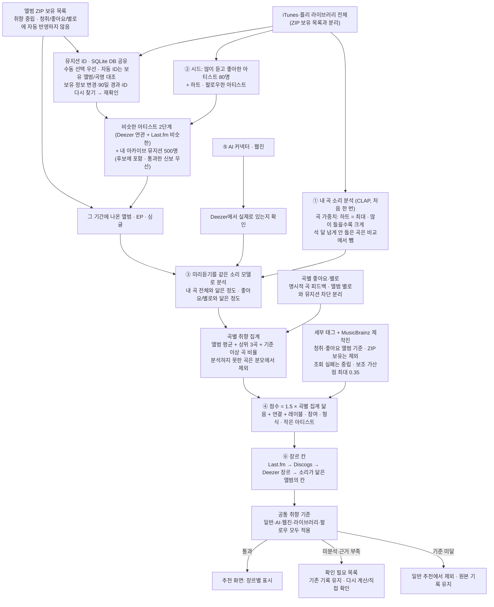

# RecipeSong 추천 방식

RecipeSong이 기간(주·월·연)마다 신보를 고르는 방식을 정리한 문서입니다. 곡별 취향 점수·불호와 공통 필터는 2026-11-04, 뮤지션 ID DB는 2026-11-02 코드 기준입니다.

## 한눈에 보기


색 테두리 상자는 추천 방식 변경·통합 뮤지션 ID DB·취향과 분리한 ZIP 보유 정보를 표시합니다. 그림 원본은 `docs/images/recommendation.mjs`(shorts-deck 스킬로 SVG 생성), 같은 흐름의 글 버전은 아래 mermaid입니다.



LLM은 ⑤의 AI 커넥터에서만 씁니다. ①~④는 모두 내 PC에서 도는 소리 모델과 통계 계산입니다. 국적(지역)은 나누지 않습니다.

## 1. 내 취향 데이터

플레이리스트로 레시피를 정하지 않습니다. 내 아카이브 전체가 취향 데이터이고, 곡마다 가중치를 매겨 많이 듣고 좋아하는 곡을 더 중요하게 다룹니다.

### 곡 가중치

계산 규칙은 Python(`ml/library.py`)과 C#(`TrackRecord.Weight`)이 같습니다.

| 조건 | 가중치 |
|---|---|
| iTunes에서 "별로" 표시 | 0.1 |
| 하트(loved) 또는 별점 4개 이상 | 1.0 (최대) |
| 그 밖 | 0.35 + 0.65 × min(1, log(1+재생 수) / log(13)) |

"그 밖"의 곡은 아래처럼 보정합니다.
- 별점 3개면 0.8 이상으로 올리고, 별점 1~2개면 0.4 이하로 내립니다.
- 스킵이 2번 이상이면 × (1 − 0.5 × 스킵 / (재생 + 스킵))
- 마지막으로 듣거나 추가한 지 180일이 넘으면 최대 30%까지 줄입니다. 3년에 걸쳐 서서히 줄어듭니다.
- 아무리 줄어도 0.1 밑으로는 내려가지 않습니다.

### 닮음 비교에 쓰는 가중치

신보가 내 곡과 얼마나 닮았는지 잴 때는 위 가중치를 넓게 폅니다(`Track.taste_weight`).

| 조건 | 비교 가중치 |
|---|---|
| 하트 또는 별점 4개 이상 | 1.0 |
| 한 번도 안 듣고 하트·별점도 없이 넣은 지 90일이 넘은 곡 | 0 (비교에서 뺌) |
| 그 밖 | 0.3 + 0.7 × 곡 가중치 |

받아만 두고 듣지 않는 곡이 취향을 흐리지 않게 하려는 것입니다. 최근에 넣은 곡은 아직 들을 틈이 없었을 수 있어 빼지 않고 낮게만 칩니다. 만든 사람 라이브러리에서는 15,333곡 중 4,666곡이 빠집니다(2026-10-29).

하트·재생 수가 바뀌면 iTunes가 라이브러리 XML을 다시 쓰고, 소리 서비스가 그것을 다시 읽을 때 가중치에 바로 들어갑니다. 다시 분석하지 않습니다.

## 2. 소리 모델

- 곡마다 25% · 50% · 75% 지점에서 10초씩 잘라 CLAP(`laion/larger_clap_general`)으로 512차원 벡터를 만들고 평균합니다. GPU에서 처음 한 번만 하고, 대상은 약 14,500곡입니다.
- iTunes에 곡이 추가되면 새 곡만 분석합니다. "iTunes에 곡이 추가되면 자동으로 분석"을 켜 두면 이 과정이 자동으로 돕니다(설정 → 취향 모델).
- 분류기는 학습하지 않습니다. 라이브러리 전체 곡 벡터의 평균(쏠림)을 구해 두고, 비교할 때마다 평균을 빼고 다시 정규화합니다(`ml/train.py`, 몇 초). 예전(레시피 분류기) 모델 파일이 있으면 소리 서비스가 뜰 때 평균만 다시 냅니다.

## 3. 후보 모으기

### 내 아카이브 뮤지션

곡 가중치 합 상위 500명입니다(곡이 2곡 이상이거나 하트를 준 곡이 있는 사람만). 이들의 신보는 후보에 항상 포함하지만, 화면에서는 **공통 취향 기준을 통과한 신보만 우선** 보여 줍니다. 근거가 부족한 것은 ‘확인 필요’에 남깁니다. 카드에는 "내 아카이브" 배지가 붙습니다. Deezer에서 이름이 정확히 같고 디스코그래피에 내 곡·앨범 제목이 하나라도 있어야 같은 뮤지션으로 봅니다.

### 추가 제안

1. **시드**: 라이브러리에서 곡 가중치 합 상위 80명. 하트를 누른 앨범·곡의 아티스트와 팔로우한 아티스트도 넣습니다.
2. **1단계**: 시드마다 Deezer 연관 아티스트 25명을 가져와 연결 점수를 매깁니다. 점수는 시드 가중치 × (1 − 0.7 × 순위/25)입니다.
   Last.fm 키가 있으면 Last.fm 비슷한 아티스트(`artist.getSimilar`) 12명도 더합니다. 점수는 시드 가중치 × (1 − 0.7 × 순위/12) × (0.5 + 0.5 × 닮음)이고, Deezer 연관과 겹치면 더해져 위로 올라갑니다.
   Last.fm 은 이름만 주므로 Deezer 에서 **이름이 정확히 같은** 아티스트로 잇습니다(동명이인·비슷한 이름은 버립니다, 90일 캐시). Last.fm 결과는 14일 캐시합니다.
   Last.fm 은 청취 기록 전체로 잇기 때문에 Deezer 연관이 비거나 약한 인디·한국 아티스트에서 차이가 큽니다(예: Q the trumpet 은 Deezer 연관 0명, Last.fm 8명).
3. **2단계**: 1단계 상위 아티스트(기본 120명, Last.fm 으로 들어온 아티스트 포함)마다 Deezer 연관 아티스트 15명을 더 가져옵니다. 점수는 1단계 점수의 0.5배에서 시작합니다.
   2단계는 Deezer 만 씁니다. Last.fm 이름을 Deezer 에서 찾는 데 요청이 들어서, 2단계까지 하면 처음 한 번이 몇 분 걸립니다.
4. 연결 점수 상위 아티스트(기본 1,000명)의 디스코그래피에서 **그 기간에 나온 발매작**을 고릅니다.

### 추천 양 (추천 설정)

| 추천 양 | 후보 아티스트 | 2단계 출발 | 소리를 들을 추가 제안 | 소리를 들을 아카이브 뮤지션 발매작 |
|---|---|---|---|---|
| 기본 | 1,000 | 120 | 150장 | 300장 |
| 많이 | 2,000 | 200 | 300장 | 500장 |
| 최대 | 3,000 | 300 | 500장 | 800장 |

월 단위는 소리를 듣는 장수가 4배, 연 단위는 12배입니다. 그래서 한 달을 봐도 주 단위로 네 번 본 것만큼 촘촘합니다.

### 빼는 것

- 이미 라이브러리에 있는 앨범, 컴필레이션
- 차단한 아티스트·레이블. 동명이인으로 막은 Deezer 아티스트는 그 사람만 뺍니다.
- 원래 앨범이 있는 인스트루멘털 버전. "(Instrumental)", "(Inst.)" 등이 해당하고, 원래 앨범은 Deezer 디스코그래피·같은 결과·내 아카이브에서 찾습니다.
- "아는 아티스트 빼기"를 켜면, 라이브러리에 곡이 있는 아티스트를 추가 제안에서 뺍니다.
- 별로 표시한 앨범만 숨깁니다. 같은 뮤지션의 다른 앨범은 후보로 유지하고, 아티스트 전체 제외는 명시적인 뮤지션 차단으로만 처리합니다.

## 4. 신보 듣기

신보마다 Deezer 30초 미리듣기(전곡 최대 20곡 또는 인기곡 3곡)를 받아 곡마다 앞·중간·뒤 10초로 자르고, 같은 소리 모델로 분석합니다. 결과는 앨범 단위로 저장해 두고 다시 쓰기 때문에 같은 앨범을 두 번 듣지 않습니다.

| 값 | 계산 |
|---|---|
| 취향 닮음 | 앨범 평균 벡터 점수에 곡별 상위 3곡 점수와 적합 곡 비율을 보완 (아래 참고) |
| 비슷한 내 곡 | 위에서 가장 닮은 3곡. 카드에서 내 파일로 바로 재생됩니다 |
| 좋아요 닮음 | 좋아요 목록 중 가장 닮은 3개의 평균 유사도 |
| 별로 닮음 | 별로 목록 중 가장 닮은 3개의 평균 유사도 |

### 곡별 집계 (2026-11-03)

기존 앨범 평균 벡터와 내 곡의 가중 유사도 상위 20곡 평균을 `기본`으로 둡니다. 각 수록곡도 같은 방식으로 점수를 구하고, 분석된 곡 중 상위 3곡 평균을 `상위`, 기준 이상인 곡의 비율을 `비율`로 둡니다.

`취향 닮음 = 기본 + min(1, 분석 곡수 / 3) × [0.35 × (상위 − 기본) + 0.04 × (비율 − 0.5)]`

적합 기준은 내 라이브러리의 비교 가중치 0.8 이상인 곡 중 최대 96곡을 자기 자신을 제외한 이웃과 비교한 점수의 하위 25%입니다. 해당 곡이 없으면 비교 가중치가 양수인 곡을 씁니다. 기준을 구할 수 없거나 곡별 벡터가 없으면 기본 점수를 유지합니다. 재생·스킵·좋아요가 달라지면 기준도 라이브러리 재조회 때 갱신됩니다.

미리듣기 실패·미지원 곡은 불호로 간주하지 않습니다. 비율의 분모는 분석된 곡 수이며, 전곡 모드도 최대 20곡·인기곡 모드는 최대 3곡이므로 전체 수록곡 적합률과는 다릅니다. 곡 벡터와 평균 벡터는 재사용하고, 예전 캐시는 곡 ID 목록만 보완합니다. 카드의 ‘비슷한 내 곡’ 제목 툴팁에 분석 곡수와 적합 비율을 표시합니다.

## 5. 점수

한 기간의 추가 제안끼리 비교한 z점수(평균 0, 표준편차 1)로 더합니다. 그래서 소리 모델이 바뀌어도 점수 비중은 그대로 유지됩니다.

```
점수 = 1.5 × 취향 닮음(z)
     + 연결 비중 × 아티스트 연결(z, log 연결 점수)      ← 추가 제안만
     + 1.0 × 좋아요 닮음(z)
     − 1.0 × max(0, 별로 닮음(z))
     + 1.0 × 좋아하는 레이블(0~1)
     + 0.6   좋아하는 아티스트가 수록곡에 참여했으면
     + 형식 가산점(앨범 / EP / 싱글)
     + 작은 아티스트 우대                              ← 추가 제안만
     + 세부 태그·제작진 보완 (최대 0.35)
```

예전에는 "2 × 레시피 어울림"이 있었습니다. 레시피를 없애면서 그만큼 소리 비중이 줄지 않게 취향 닮음을 1.5배로 올렸습니다.

| 항목 | 내용 |
|---|---|
| 연결 비중 (모험 정도) | 익숙하게 1.0 · 보통 0.5 · 새롭게 0.0 |
| 좋아하는 레이블 | 가중치 제곱 합 상위 300개 앨범의 레이블을 Deezer에서 확인해 레이블별 √(합/최대)로 매깁니다. 메이저·유통사는 뺍니다 |
| 형식 가산점 | 내 아카이브에서 앨범·EP·싱글을 듣는 비율 |
| 작은 아티스트 | Deezer 팬 5천 명 미만 +0.4, 5만 명 미만 +0.2, 100만 명 초과 −0.2 |
| 소리를 못 들은 앨범 | 미리듣기가 없으면 −1에서 시작해 뒤로 갑니다 |

### 세부 태그·제작진 보완 (2026-11-03)

소리 중심 점수 상위 12장에만 적용합니다. 내 라이브러리에서 앨범별 `max(0, 곡 가중치 − 0.35)` 합 상위 12장을 취향 근거로 삼습니다. ZIP 보유·위시리스트·단순 팔로우는 근거로 쓰지 않습니다.

- 태그: 기존 Last.fm 앨범 → 아티스트 → Discogs 자료를 재사용합니다. `rock`, `pop` 등 넓은 태그를 빼고 하이픈·공백을 정규화합니다. 겹치는 태그 상위 3개의 취향 근거 비중 평균을 사용합니다.
- 제작진: MusicBrainz에서 앨범명과 아티스트명이 정확히 맞고 아티스트 MBID가 하나로 확인되는 발매판만 사용합니다. 제작진은 MBID와 역할로 비교합니다. 프로듀서 1.0, 작곡가 0.7, 연주·보컬 0.35의 역할 비중을 적용하며 엔지니어·마스터링은 제외합니다. 이름만 같은 제작진을 연결하지 않습니다.
- 가산점: `0.15 × 태그 + 0.15 × 제작진 + 0.05 × min(태그, 제작진)`. 일치하지 않거나 자료가 없으면 0입니다. 추천 후보 수집을 대체하거나 소리 점수를 건너뛰지는 않습니다.
- 조회: 전체 보완에 15초 한도, 제작진 신규 조회는 근거 앨범 3장·후보 3장까지입니다. MusicBrainz 요청은 1.1초 이상 간격으로 직렬 처리하고 180일 캐시를 재사용합니다. 403·429·503은 재시도 없이 5분간 새 요청을 쉬고 다음 계산에서 보완합니다. 남은 조회는 다음 계산으로 이어집니다.

추천 품질 개선은 아직 실사용 청취 평가로 확정하지 않았습니다. 가산점·집계 계수는 초기값이며, 같은 곡 집합의 전후 점수와 회귀 시험으로 계산 경로를 확인합니다. 추천 캐시가 이미 있으면 앱을 새 빌드로 다시 실행한 뒤 ‘다시 계산’해야 새 순위가 반영됩니다.

2026-11-03 읽기 전용 비교에서는 라이브러리 벡터 14,633개와 앨범 64장을 사용하고 같은 아티스트를 비교 대상에서 제외했습니다. 전후 점수가 오른 앨범은 35장, 내려간 앨범은 29장입니다. 명시적 선호·청취 신호를 가진 양성은 5장, 명시적 불호인 음성은 0장이어서 AUC 개선 여부는 평가할 수 없습니다. 미청취·중립을 불호 정답으로 취급하지 않습니다. 모델·음원·임베딩은 변경하지 않았습니다.

재현: `ml/.venv/Scripts/python.exe -I tests/evaluate_album_scoring.py --out <별도 결과 JSON>` (필요하면 `--xml <라이브러리 XML>`). `tests/test_album_scoring.py`는 집계·비율·작은 라이브러리·서비스 반환 경로를, `Soulseek.Checks --metadata`는 가짜 HTTP와 별도 캐시로 태그·제작진 조합·오인 배제·조회 실패·취소를 검증합니다. 실제 MusicBrainz 자료의 충실도와 실사용 선호도는 별도 확인이 필요합니다.

### 추천 근거 상세 보기

카드의 ‘추천 근거 보기’ 또는 우클릭 메뉴에서 열면 기존 오른쪽 앨범 패널의 ‘추천 근거’ 탭으로 이동합니다. ‘수록곡’ 탭과 전환할 수 있으며, 근거를 여는 것만으로 소리 분석을 새로 요청하지 않습니다.

- 계산 당시 실제로 더한 소리·연결·좋아요·별로·레이블·참여·형식·작은 아티스트·메타데이터 기여분을 저장해 보여 줍니다. 기여분의 합은 저장된 정렬 점수와 같습니다. 음수도 그대로 표시하고 확률이나 별점으로 바꾸지 않습니다.
- 앨범 평균 벡터 점수, 상위 최대 3곡 평균, 라이브러리 적합 기준, 분석 곡수와 적합 비율을 표시합니다. 곡별 점수는 높은 순으로 나열하며 ‘기준 이상/미만’은 반올림 전의 실제 판정을 저장해 사용합니다.
- 출발 아티스트·태그·제작진·레이블·참여 아티스트·AI/웹진 이유와 닮은 내 곡을 함께 보여 줍니다. 근거가 없는 것은 자료 누락 또는 미확인일 수 있으며 불호를 뜻하지 않습니다.
- 예전 추천은 남아 있는 정보만 표시합니다. 세부 점수를 역산하거나 새 분석처럼 가장하지 않고 ‘다시 계산’ 안내를 보여 줍니다. 예전 소리 캐시는 곡 제목 목록만 보완하며 곡 임베딩을 재사용합니다.
- 내 라이브러리·팔로우 신보의 우선 배치와, 서로 다른 기간·추천 묶음의 정렬 점수를 직접 비교할 수 없다는 한계를 안내합니다.

### 공통 취향 기준과 곡별 불호 (2026-11-04)

모든 추천 출처에 같은 `TasteGate`를 적용합니다. 일반·AI·웹진·내 라이브러리·팔로우 여부나 높은 정렬 점수로 우회하지 않습니다. 이전의 AI·웹진 전용 하위 25%/0.48 필터는 제거했습니다.

- 기본적으로 3곡 이상 분석한 앨범에서 적합 곡 2곡 이상을 요구합니다. 싱글은 분석·적합 곡 각각 1곡이면 됩니다. 실제 전체 곡 수가 1~2곡으로 확인된 앨범·EP는 그 수에 맞게 최소 조건을 줄입니다.
- 적합 여부는 각 사용자 라이브러리의 곡별 기준을 넘고, 곡별 불호 쪽에 더 가깝지 않은지를 사용합니다. 직접 ‘별로’를 누른 곡은 저장된 긍정 판정이 있어도 적합 곡 수에서 즉시 뺍니다.
- 미분석, 이전의 세부 기록 부재, 부족한 분석 곡수는 ‘확인 필요’ 칩에서 별도로 볼 수 있습니다. 이들을 불호로 학습하거나 삭제하지 않습니다. 충분히 분석했지만 적합 곡이 부족한 앨범은 일반 추천에서 제외하고 개수만 안내합니다. 원본 추천 기록은 유지합니다.
- 수록곡의 ‘별로’는 `disliked-tracks.json`에 저장합니다. 같은 곡의 하트와 상호 배타적으로 갱신하며, 현재 재생 중인 곡이면 샘플을 멈춥니다. 자동 다음 곡·이전/다음 곡 탐색은 별로 곡을 건너뜁니다. 명시적으로 곡을 눌러 다시 들어 보는 것은 가능합니다.
- 소리 서비스는 불호 곡과 아티스트·곡명이 일치하는 라이브러리 곡을 긍정 비교 대상에서 제외합니다. 새 후보 곡이 강한 긍정 기준 곡보다 명시적 불호 곡에 코사인 유사도 0.03을 초과해 더 가까우면, 초과 차이의 0.5배를 곡 점수에서 빼고 적합 곡 수·상위곡 후보에서도 제외합니다. 같은 정규화 공간의 유사도끼리 비교하며, 긍정/불호 벡터가 없으면 이 보정을 하지 않습니다.
- 곡 피드백은 최신 상태를 소리 서비스에 보낸 뒤 다음 ‘다시 계산’부터 유사 곡 점수에 반영합니다. 이미 저장된 추천 점수를 즉석에서 새로운 점수처럼 표시하지 않습니다. ZIP 보유·미청취를 곡별 불호로 만들지 않습니다.

숫자는 정확도 우선을 위한 초기 기준입니다. 명시적 불호 표본이 부족해 실사용 추천 품질 개선은 아직 확인하지 못했습니다. 같은 앨범에서 일부 곡만 좋아하는 경우를 보존하도록 적합 비율이 낮다는 이유만으로 앨범을 일괄 제외하지는 않습니다.

## 6. 장르 칸

국적과 상관없이 장르로만 나눕니다. 일본 인디도 영국 인디도 같은 칸입니다.


| 칸 | 예 |
|---|---|
| 인디·록 | indie, shoegaze, dream pop, rock, punk, folk, singer-songwriter, metal, post-rock, blues |
| 일렉트로닉 | electronic, house, techno, ambient, idm, dance, disco, synth-pop |
| 힙합·R&B | hip hop, rap, r&b, soul, funk |
| 재즈 | jazz, bossa nova |
| 클래식·OST | classical, soundtrack, film, game |
| 그 밖 | reggae, latin, brazilian, african, world |

"pop", "k-pop", "j-pop", "Asian Music", 국적·연도 같은 넓은 태그로는 칸을 정하지 않고 다음 단계로 넘어갑니다. 칸은 아래 순서로 정합니다(`GenreGroups`, `ReleaseRecommender.GroupsAsync`).

| 순서 | 출처 | 조건 |
|---|---|---|
| 1 | Last.fm 앨범 태그 → 아티스트 태그 | 키가 있을 때. 10명 이상이 붙인 태그만, 많이 붙은 순 |
| 2 | Discogs 스타일 → 장르 | 개인 토큰을 넣었을 때만 |
| 3 | Deezer 장르 | 앨범 상세 또는 디스코그래피 목록의 장르 id |
| 4 | 소리가 닮은 앨범 | 이 목록에서 칸을 아는 앨범 중 가장 닮은 15장의 유사도 가중 투표 |
| 5 | 그래도 모르면 | 인디·록 (가장 흔한 칸) |

- Last.fm·Discogs 태그는 오래 캐시합니다(앨범 180일, 아티스트·Discogs 365일). 못 찾은 것도 캐시해 다시 묻지 않고, 네트워크 실패는 캐시하지 않습니다.
- 한 번 계산할 때 새로 묻는 앨범은 점수 높은 순 60장까지입니다(Last.fm 250ms, Discogs 1.1초 간격). 나머지는 결과를 그린 뒤 뒤에서 최대 300장까지 받아 두고, 다음 계산부터 씁니다.
- 카드의 장르 배지는 칸을 정한 것과 같은 Last.fm 태그(앨범 태그가 없으면 아티스트 태그, Discogs) 중 장르로 읽히는 것 최대 3개입니다. "pop"·"k-pop"처럼 칸은 못 정하는 태그도 배지로는 보이고, "seen live"·국적·아티스트 이름은 뺍니다. 카드를 그릴 때마다 캐시에서 채우므로, 뒤에서 받은 태그는 다음에 그 기간을 열 때 붙습니다.
- 소리 장르 태그(EffNet Discogs 스타일)로 칸을 정하던 단계는 뺐습니다. Last.fm에 물어본 추천 1,109장 중 소리로 칸을 정한 것은 38장(약 3%)이었고 그중 24장은 기본값과 같은 인디·록이었는데, 그 몇 장을 위해 미리듣기 곡마다 모델을 하나 더 돌려야 했습니다. 태그가 없는 작은 아티스트는 닮은 앨범 투표(4단계)가 맡습니다.
- 레시피로 나누던 때 저장한 결과는 열 때 장르 칸으로 옮깁니다: Deezer 장르 → 저장된 장르 태그 → 예전 칸 이름(Club·해외 일렉트로닉 → 일렉트로닉, 해외 소울·힙합 → 힙합·R&B, Jazz → 재즈, 나머지 → 인디·록).

## 7. 앱에서 남기는 신호

모델을 다시 학습하지 않고, **누르는 즉시 다음 분석부터** 좋아요·별로 목록에 반영됩니다.

| 행동 | 반영 |
|---|---|
| 앨범 하트 · 곡 하트 | 좋아요 목록 (닮은 신보 +) |
| 미리듣기를 2곡 이상 끝까지, 넘긴 것보다 훨씬 많이 | 은근한 좋아요 |
| 앨범 별로(👎) | 해당 앨범 숨김 · 비슷한 소리 감점. 뮤지션 전체를 제외하지 않습니다 |
| 곡 별로(👎) | 곡별 불호 저장 · 하트 해제 · 재생 중이면 중단 · 유사 곡 점수 보정 |
| 미리듣기를 2번 이상 바로 넘기고 끝까지 들은 적 없음 | 은근한 별로 |
| 차단 — 소리 때문(전반적 취향 · 보컬 · 장르 · 사운드) | 빼고, 그 앨범을 별로로 학습 |
| 차단 — 다른 이유(동명이인 · 이미 앎 · 너무 유명 · 너무 잦은 발매 · 재발매 위주 · 가사·언어 · 음악 외적 · 기타) | 빼기만 합니다. 동명이인은 그 Deezer 아티스트만 막습니다 |
| 저장함(북마크) | **반영하지 않습니다** (위시리스트 전용) |

차단을 풀면 그 차단으로 들어간 학습 신호도 같이 빠집니다.

재생 중인 앨범을 관심 없음으로 지정하거나 해당 뮤지션·레이블을 차단하면 미리듣기를 즉시 종료하고 다음 곡 자동 재생도 해제합니다. 다른 앨범의 관심 없음이나 무관한 뮤지션 차단은 현재 재생에 영향을 주지 않습니다. 샘플 조회 중에 제외한 앨범도 조회가 끝난 뒤 재생하지 않으며, 제외를 되돌려도 자동으로 재개하지 않습니다.

## 8. 외부 추천

| 출처 | 가져오는 방식 |
|---|---|
| AI 커넥터 (Claude · GPT) | 웹 검색으로 그 기간의 신보를 찾습니다. 직접 입력한 API 키를 쓰고, 예산 한도 안에서만 돕니다. 취향 요약으로 라이브러리에서 많이 듣는 아티스트 60명과 앱에서 남긴 신호를 보냅니다 |
| 웹진 RSS | Pitchfork, The Quietus, Aquarium Drunkard, Bandcamp Daily, Stereogum. 6시간마다 새 글만 읽습니다. 국내 웹진은 RSS를 막아 두었거나 제공하지 않아서 없습니다 |

- 두 출처 모두 "아티스트 – 앨범"을 Deezer에서 확인합니다. 확인 순서는 검색 상위 10개 → 그 아티스트 디스코그래피에서 같은 제목 → 기간 안의 발매작입니다. 확인 못 한 것은 뺍니다.
- 확인한 것은 일반 추천과 같은 방식으로 점수를 매기고 **모든 출처에 같은 곡별 취향 기준**을 적용합니다. 미분석·근거 부족은 ‘확인 필요’로 분리하며, 내 아카이브·팔로우 뮤지션도 기준을 우회하지 않습니다. 예전의 AI·웹진 전용 하위 25%/0.48 규칙은 사용하지 않습니다.
- 숨긴 앨범도 점수와 함께 저장해 둡니다. 다시 찾거나 다시 점수를 매기지 않게 하려는 것입니다.
- 카드에는 배지가 붙습니다(Claude 오렌지 / GPT 초록 / 웹진 보라).
- AI에게는 그 기간에 AI가 이미 제안한 앨범만 "다시 제안하지 말 것"으로 보냅니다. 일반 추천에 있는 앨범도 고를 수 있고, 고르면 그 카드에 AI 배지와 이유가 함께 붙습니다. "지우고 다시 찾기"를 하면 AI만 찾은 카드는 빠지고, 일반 추천에도 있던 카드는 배지와 이유만 떨어집니다.

## 9. 저장과 다시 보기

- **앨범 ZIP 보유 경로**: 일반 설정의 **앨범 ZIP 아카이브**에서 경로를 등록하고 보유 정보를 다시 읽습니다. 하위 폴더의 ZIP 음원 태그에서 앨범 아티스트·앨범명·연도·곡 수를 읽으며, 태그가 없을 때만 RecipeSong 표준 ZIP 이름으로 보완합니다. ZIP은 수정하거나 압축 해제하지 않습니다. 읽을 수 없거나 식별할 수 없는 파일은 경고하고 보유로 추측하지 않습니다. 변경되지 않은 ZIP의 정보는 재사용하고 경로가 오프라인이면 마지막 성공 결과를 유지합니다. 등록 해제는 설정에서만 빼며 파일을 지우지 않습니다.
- **보유와 취향 분리**: ZIP 소장은 중복 추천 제외·놓친 앨범의 전체/일부 보유 판정·뮤지션 ID의 앨범명 대조에만 사용합니다. ZIP만 가진 뮤지션을 플리 아티스트에 추가하거나, 재생 수·좋아요·별로·소리 모델 학습에 넣지 않습니다. 플리에 없는 앨범도 중립이며 기존의 명시적인 앨범별 좋아요·별로 기록은 그대로 유지합니다. 저장된 일반·AI 추천에도 ZIP 보유 제외를 적용합니다.
- **작업 현황 흐름도**: 처리 단계는 사각형, 데이터·저장소는 원통형, 규칙은 모서리가 접힌 메모형으로 표시하며 이름·설명을 각 도형 안에 넣습니다. 라이브러리와 ZIP 보유 목록을 분리하고, ZIP은 보유 제외·뮤지션 ID 대조에만 연결합니다. SQLite ID 저장소와 기간별 추천 저장 결과의 재사용 경로도 표시합니다. ZIP 읽기는 추천 계산과 독립된 작업으로 개수·단계·현재 경로를 표시하며 취소·실패를 완료로 표시하지 않습니다. 긴 문구와 경로는 해당 칸의 툴팁에서 확인할 수 있습니다.
- **흐름도 읽기**: 기본 100% 크기에서 가로·세로로 스크롤하며, 75~200% 확대·축소와 원래 크기 복귀를 제공합니다. 진행 단계를 자동으로 따라가며, 따라가기를 끄면 다른 칸을 직접 살펴볼 수 있습니다. 진행 기록은 기본으로 접혀 있고 필요할 때 펼칩니다. 건너뛴 단계도 제목과 설명의 대비는 유지합니다.
- **노드 상세와 전체 개요**: 도형을 클릭하거나 Tab으로 선택하면 전체 설명·진행 문구·경로를 고정 상세 영역에 표시합니다. Enter로 상세 읽기 영역에 진입해 내용을 선택·복사할 수 있습니다. 직접 선택하는 동안 자동 따라가기는 멈춥니다. 전체 개요는 모든 칸의 이름과 상태를 목록으로 보여 주며, 방향키 선택으로 같은 상세 정보를 확인할 수 있습니다.
- **ZIP 실패·취소**: 실패와 사용자 취소를 별도 배지로 구분합니다. 추천 계산이 끝나도 ZIP 읽기 실패·취소는 상단 요약에 남고, 다시 읽기에 성공하면 해제됩니다. ID 저장소의 입력선은 위쪽, 출력선은 오른쪽으로 나눠 연결 방향을 구분합니다.
- **복구와 접근성 알림**: ZIP 실패·취소 안내에서 다시 읽기와 일반 설정 열기를 제공합니다. 재시도 중에는 중복 실행을 막고, 이 창을 닫으면 이 창에서 시작한 재시도만 취소합니다. 상태 요약은 WPF UI Automation의 Polite 알림으로 단계·결과 변경을 전달하며 매초 시간·개수·경로 갱신은 반복해서 알리지 않습니다.

- **추천 설정 탭**: 추천 방식(추천 양·모험 정도·들을 곡·촘촘한 계산), 제외 설정(아는 아티스트·인스트루멘털·라이브·리믹스·차단과 닮은 추천), 웹진, 팔로우·차단으로 나눕니다. 저장·취소 버튼은 아래에 고정하고 각 탭 본문만 스크롤합니다. 탭을 바꿔도 편집 중인 값은 유지하며 기존 저장 동작을 그대로 사용합니다.
- **목록 변경 저장**: 웹진 선택·팔로우 해제·차단 해제는 창 안에서 임시로 편집하며 저장할 때만 적용합니다. 취소·Esc·창 닫기는 변경을 버립니다. 목록만 바꿔도 저장 후 메인 화면을 갱신합니다. 웹진의 "지금 새로 읽기"는 현재 선택으로 글을 읽지만 선택 자체를 저장하지는 않습니다. 팔로우·차단 검색에 일치하는 항목이 없으면 안내와 검색어 지우기 버튼을 표시하고, 긴 목록은 탭 본문의 스크롤 하나로 봅니다.
- **팔로우 협업 앨범**: 여러 팔로우 아티스트의 디스코그래피에 같은 Deezer 앨범 ID가 있어도 전체 목록에서 한 번만 분석하고 표시합니다. 아티스트별 중복 제거만으로는 협업 앨범이 남아 추천을 합칠 때 같은 키 오류가 발생할 수 있으므로 분석 전에 전체에서 중복을 제거합니다.
- **추천 도구 모음**: 다시 계산은 회전 화살표, 현황은 흐름도, 추천 설정은 슬라이더 아이콘으로 표시해 일반 설정의 톱니와 구분합니다. 각 버튼은 툴팁과 접근성 이름을 유지하며 AI 찾기·현재 필터·초기화 옵션은 글자로 표시합니다.
- **계산 결과 저장**: 기간 · 추천 설정마다 저장합니다. 지난 기간은 저장 결과를 그대로 쓰고, 끝난 지 7일이 안 된 기간은 12시간만 씁니다. "다시 계산"을 누르면 새로 계산합니다.
- **월·연 경계 주 재사용**: 월·연과 겹치는 첫 주의 월요일부터 마지막 주까지 주 전체를 계산·저장합니다. 1월 초에 걸친 전년도 주, 12월 말에 걸친 다음 연도 주도 자르지 않아 연간 계산 후 1월·12월과 개별 주를 열면 같은 저장 결과를 사용합니다. 현재 주도 포함하며 아직 시작하지 않은 주는 계산하지 않습니다. 합쳐 보여 줄 때만 선택한 월·연의 발매일로 거릅니다. 후보가 없어 정상 완료한 0장 결과도 저장하며, 라이브러리 후보 수집 대기·소리 분석 실패·취소 결과는 완료로 저장하지 않습니다. 예전 계산에서 저장되지 않은 빈 주는 한 번 다시 계산해야 하며, 진행 중인 주의 유효 시간이 지난 경우에도 새로 계산할 수 있습니다.
- **뮤지션 ID DB**: `artist-identities.sqlite3`를 일반 추천·놓친 앨범 찾기가 함께 사용합니다. 수동 ID 우선이며 자동 ID는 보유 정보 지문이 같고 90일 안인 경우만 재사용합니다. 옛 JSON ID는 미검증 힌트로 한 번 이관합니다. 일반 "다시 계산"은 ID를 유지하고, 아티스트 화면의 "ID 다시 찾기"는 해당 ID를 삭제 후 재대조합니다. DB 버전 변경 시 다음 계산에서 후보 풀을 다시 만듭니다. 첫 전환에서는 재검증으로 오래 걸릴 수 있습니다.
- **촘촘한 계산**: **추천 설정 → 추천 방식 → 계산 방식 → 주별로 촘촘히 계산** 체크박스에 있으며 기본으로 켜져 있습니다. 예전 설정 파일에 이 항목이 없어도 기본값을 적용하고, 사용자가 끄고 저장하면 재실행 후에도 해제 상태를 유지합니다. 월·연에서 "다시 계산" 또는 설정의 "저장하고 다시 찾기"를 누르면 주별로 계산해 합칩니다. 주 보기에서는 일반 방식으로 계산합니다. 체크만 바꾸거나 취소하면 실행하지 않으며, 취소 시 기존 설정을 유지합니다. 기간 이동의 자동 불러오기에는 적용하지 않습니다. 실행 중에는 체크 변경을 막고 진행 표시 옆 "멈추기"로 중단합니다. 소리를 듣는 양은 연 기준 주 52 × 150장으로 예전 월 단위(12 × 600장)와 비슷하며 저장된 주는 건너뜁니다. 예전 월 단위 연 결과도 그대로 합쳐 보여 줍니다.
- **NEW**: 어느 기간에서든 화면에 처음 나온 앨범에 붙고, 앱을 끌 때까지 유지됩니다. 달력에서는 아직 화면에서 보지 않은 앨범이 있는 날에 점을 찍습니다.

## 10. 실험 기록

### 소리 모델 비교 (레시피 분류기를 쓰던 때)

같은 13,996곡으로 비교한 결과입니다. 지금은 분류기를 쓰지 않지만, 소리 모델을 바꿀 때 참고로 남깁니다.

| 소리 모델 | 레시피 | 지역 |
|---|---|---|
| CLAP (현재) | 73.1% | 78.1% |
| Discogs-EffNet (장르판) | 72.1% | 73.2% |
| CLAP + EffNet | 73.9% | 80.0% |

- EffNet은 MTG(Essentia) 연구실의 모델로, Discogs 스타일 400개를 학습했습니다. ONNX로 CPU에서 돌고, 라이선스는 CC BY-NC-SA(개인용)입니다. 카드 장르 태그와 장르 칸에 쓰다가 Last.fm 태그로 바꾸면서 뺐습니다.

### 앨범 커버 (CLIP)

커버는 지역 판정에 도움이 됐지만(한국 72% → 77%), 지역을 나누지 않게 되면서 뺐습니다. 레시피와 취향에는 거의 도움이 되지 않았습니다(좋아하는 앨범 가려내기 AUC 0.675 → 0.676).
